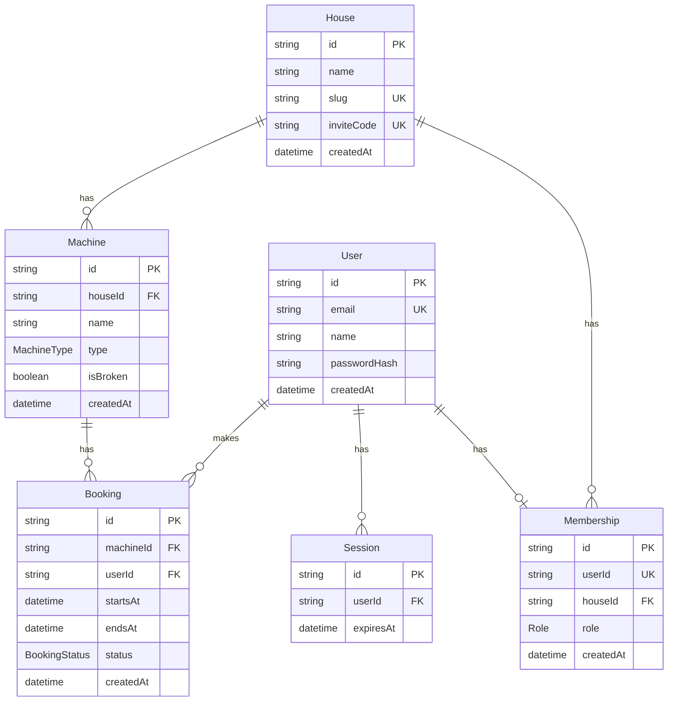

# Waschplan

A laundry room booking app for German apartment buildings. Residents join their building with an invite code and book washing machine or dryer slots on a weekly grid. Two people can never book the same slot: the database guarantees it.

**Status:** backend in progress. The backend is built first, then the React frontend.

## Local setup

Prerequisites: Node.js 24. From the repo root, `nvm use` selects it from `.nvmrc`.

```bash
npm install
cp server/.env.example server/.env
npm run dev
```

The API listens on `http://localhost:3000`. Health check:

```bash
curl localhost:3000/api/health
```

```json
{ "status": "ok" }
```

Other commands:

```bash
npm test
npm run lint
npm run format
```

## Database

Postgres 17 runs in Docker. Start Docker Desktop, then from the repo root:

```bash
docker compose up -d
```

This starts one Postgres server on `localhost:5432` with two databases: `waschplan_dev` for development and `waschplan_test` for the automated tests. User and password are both `waschplan` (local only).

npm test uses waschplan_test and needs Docker to be running.

Stop it with `docker compose down`. To delete all data and start fresh, run `docker compose down -v`.

Load the demo house with:

```bash
npm run seed
```

The house is Wittensteinstraße 12 in Wuppertal. Its slug is `wittensteinstr-12` and its invite code is `WUPP42`. It has three machines, none of them broken: Waschmaschine 1 and Waschmaschine 2 (washers) and Trockner (dryer).

All four users sign in with the password `waschplan`:

- Lena, `lena@wittensteinstr.example`, admin
- Jonas, `jonas@wittensteinstr.example`, resident
- Mira, `mira@wittensteinstr.example`, resident
- Paul, `paul@wittensteinstr.example`, resident

Running the seed again updates these same rows.

## Architecture

`server/src/server.js` listens. `createApp` in `server/src/app.js` builds the app for Supertest.

Feature code lives in `server/src/modules/<feature>/{routes,service,schemas}.js`.

Postgres and Prisma hold users, sessions, houses, memberships, machines, and bookings. Slots are computed in Europe/Berlin, not stored. One booking per machine and start time is a database unique constraint.

Auth is the `session` cookie. Passwords are bcrypt hashes and are not returned.

Middleware, in order: helmet, CORS allowlist from `CORS_ORIGINS` (default `http://localhost:5173`, credentials on, no `*`), pino-http (no logs when `NODE_ENV` is `test`; the cookie, `Set-Cookie`, password, and password hash are not logged), JSON body parser, cookie parser, routers, not-found handler, error handler.



`Role` is `ADMIN` or `RESIDENT`. `MachineType` is `WASHER` or `DRYER`. `BookingStatus` is `ACTIVE` or `AFFECTED`.

`Membership.userId` is unique. `Machine` is unique on `(houseId, name)`. `Booking` is unique on `(machineId, startsAt)` and has an index on `(userId, startsAt)`.

## server/

- `src/server.js` starts the HTTP server.
- `src/app.js` builds the Express app without listening, so tests can call it directly.
- `src/config/env.js` checks environment variables with Zod.
- `src/middleware/` adds helmet, the CORS allowlist, and request logging.
- `src/modules/health/routes.js` serves `GET /api/health`.
- `tests/` holds the Vitest tests.

Routes, examples, and error codes are in [docs/api.md](docs/api.md).

## Docs

- [docs/spec.md](docs/spec.md): what the backend does, its rules, data model and API.
- [docs/api.md](docs/api.md): every endpoint, with examples and error codes.
- [docs/backend-plan.md](docs/backend-plan.md): the build plan, split into one issue and one pull request per step.
- [AGENTS.md](AGENTS.md): conventions for code, commits and pull requests.
- [docs/project-selection.md](docs/project-selection.md): how this project was chosen from three candidates.
